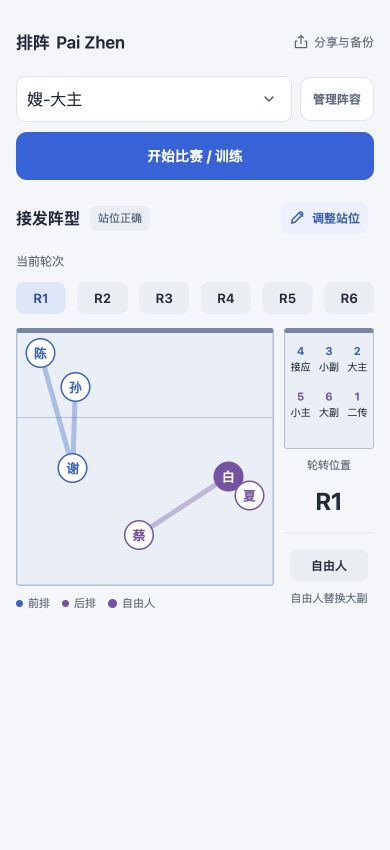
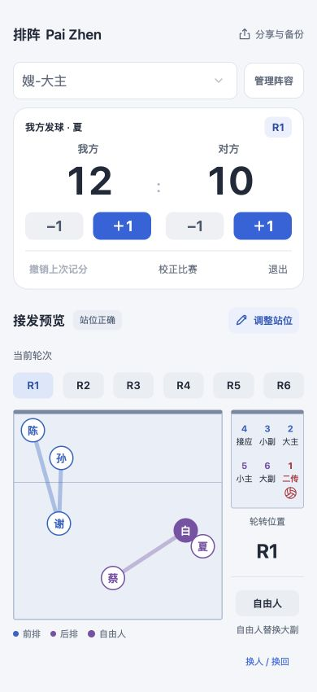
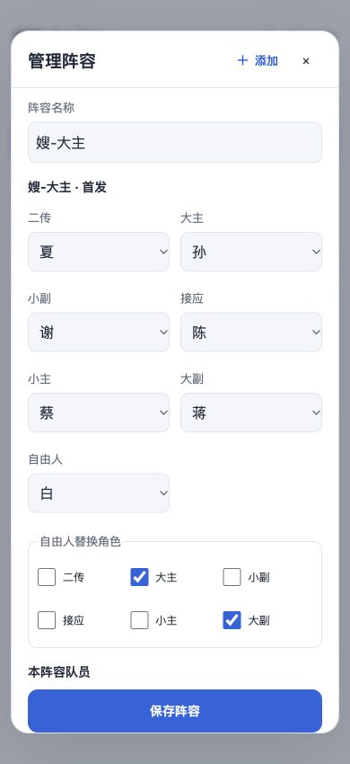

  
  <h1>排阵 Pai Zhen · 排球战术板</h1>
  
为排球训练与比赛设计的手机战术板，也是我的一次 Vibe Coding 实践。

  
<a href="https://xavieryx.github.io/Volleyball-tactics/">在线体验</a> · <a href="#界面与功能">功能展示</a>

## 为什么做排阵

这个项目来自我在排球训练和比赛中的一个需求：**能不能打开手机，就看清这一轮谁在前排、谁在后排，以及接发球时该站在哪里？**

队员相对固定，但首发、轮次和具体接发站位需要提前安排，也会在临场调整。我希望把比分、接发阵型和标准轮转小图放在同一张手机界面里，方便自己和队友在场边快速确认。

因此，排阵围绕几个具体操作展开：赛前录入队员、拖出六轮站位；比赛时记分、核对轮次；临场调整后，把这套阵容留到下次使用。

## 我如何通过 Vibe Coding 实现它

我负责提出使用场景、明确排球业务规则，并决定交互与视觉方向；通过与 **Codex** 持续进行自然语言对话，完成界面、功能、测试和部署。

项目从三套 HTML 视觉方案开始，选定简洁的 iOS 风格，再根据手机上的使用反馈逐步迭代：缩小队员标记、把撤销移到比分板、减少解释文字、调整自由人替换逻辑，随后加入多套阵容、链接分享和主屏幕安装。当前界面把记分、站位编辑与自由人操作分区呈现，用轻量图标按钮和更少的说明文字，减少场边操作时的干扰。

对我而言，Vibe Coding 的实践也包括不断把需求说具体、检查生成结果，并用排球场景验证它是否好用。例如：队员的常规位置与首发角色分开管理；大主／小主、大副／小副的角色随轮转保留；自由人可以按队伍需要替换大主或大副。

## 界面与功能

以下截图取自 **2026.10.22.11** 版本，使用我提供的阵容，在手机尺寸下实际运行；比赛比分为演示数据，非赛事记录。

<table>
  <tr>
    <th>接发站位</th>
    <th>比赛记分</th>
    <th>管理阵容</th>
  </tr>
  <tr>
    <td valign="top"></td>
    <td valign="top"></td>
    <td valign="top"></td>
  </tr>
</table>

| 功能 | 可以做什么 |
| --- | --- |
| 六轮接发阵型 | 从规整的前三人、后三人开始，拖动队员圆圈，分别保存六轮站位。 |
| 拖动校对 | 蓝紫色半透明实线区分前后排；移动时突出关联队员、淡化无关队员，并以虚线提示左右和前后关系。按圆心校验，异常关系实时标红。 |
| 轮转速览 | 标准轮转小图核对角色；我方发球时，以红色加粗显示位置数字和发球角色，名称下方附有小排球图标。自由人按钮与替换状态集中在小图下方。 |
| 比赛记分与轮转 | 双方加减分、撤销、手动校正比分和轮次；根据记分顺序跟踪发球权及我方轮转，切轮与比分变化采用快速柔和过渡。 |
| 多套阵容 | 每套阵容维护各自的队员范围、首发、六轮站位与自由人预设；在“管理阵容”中添加、重命名或移除。复制阵容可沿用现有队员，导入不会混入其他阵容的名单。 |
| 临场调整 | 修改本场站位、普通换人／换回；手动选择自由人是否上场及替换角色，检查后排身份与替换间隔。 |
| 链接分享 | 复制当前阵容的名单与阵型短链接发送给队友，粘贴链接即可预览并导入为新阵容。 |
| 手机网页 App | 无需注册，可添加到主屏幕；本机保存数据，首次联网缓存后可离线使用主要功能。 |

我方发球时，比分板显示发球队员姓名，小图标记对应角色，主球场继续显示接发预览。查看其他轮次时不显示发球标记，避免与当前比赛混淆。站位和自由人提示用于场边辅助，实际判罚以裁判及赛事规则为准。

## 开始使用

1. 手机打开 **[排阵](https://xavieryx.github.io/Volleyball-tactics/)**，在“管理阵容”中编辑当前阵容的名称、队员和首发角色。
2. 切换 R1–R6，点击“调整站位”拖动队员；需要其他组合时，点击“管理阵容”右上角的“添加”，选择复制当前站位或使用规整站位。
3. 点击“开始比赛 / 训练”，选择起始轮次、首发和发球方，开始记分。比赛中从小场地下方操作自由人或“换人 / 换回”；退出时可将本场站位保存回当前阵容。
4. 与队友共享时，使用“分享与备份”里的复制链接、粘贴导入。

**添加到 iPhone 主屏幕：** 在 Safari 的分享菜单中选择“添加到主屏幕”。若仍显示旧版，可从“分享与备份”检查更新，或打开 [独立更新页](https://xavieryx.github.io/Volleyball-tactics/update.html)。

阵容和比赛保存在当前设备的浏览器中，不会自动跨设备同步。分享链接是一次性快照；短链接通过第三方 **da.gd** 生成，收到链接的人可导入其中的名单与阵型。生成及读取短链接需要联网。

## 技术实现

原生 **HTML、CSS、JavaScript**，以静态 PWA 形式运行；使用 IndexedDB 保存本机数据，Service Worker 提供离线资源缓存，GitHub Actions 完成测试与构建，GitHub Pages 提供在线访问。

图标采用深色底与蓝黄排球组合；排球线条基于 [Lucide](https://lucide.dev/icons/volleyball) 调整，授权见 [ISC License](icons/LICENSE-lucide)。
